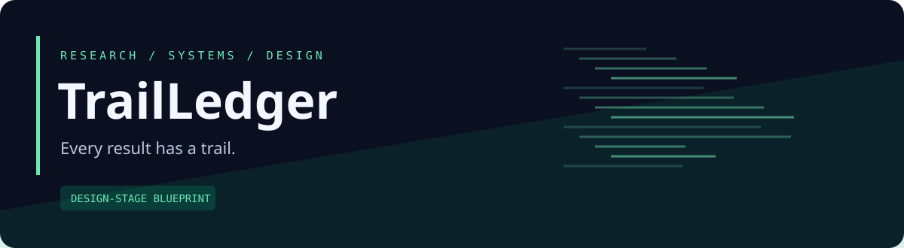
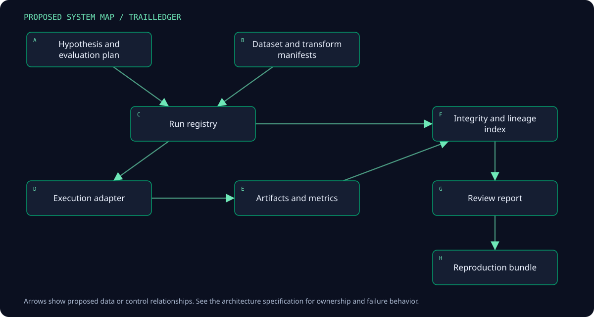

<p align="center"></p>

<p align="center"><strong>An evidence ledger for reproducible quantitative and simulation experiments.</strong></p>
<p align="center">Design stage · Documentation first · Open design · No runtime implementation yet</p>

> **Status:** This repository contains an implementation blueprint, architecture, contract specifications, and validation plan. Features below are proposed. There is no installable application, measured performance, trading track record, or completed runtime test suite in this revision. Illustrative scenarios are design examples.

## The problem

A result chart can outlive its dataset version, transformations, parameters, failed predecessors, and evaluation assumptions. Filenames and notebook outputs are weak evidence. Research becomes difficult to reproduce, and selecting only favorable experiments hides the actual search process.

## The proposal

Build a local experiment and artifact ledger that connects hypotheses, dataset manifests, transformations, configurations, execution environments, results, and review decisions. Support domain-specific metrics through adapters while keeping provenance and lifecycle semantics common.

## A concrete walkthrough

A researcher registers a hypothesis before running a parameter search. TrailLedger fingerprints the dataset and records every trial, including failures. An attractive result is later corrected because a feature used information unavailable at decision time. The corrected experiment becomes a new lineage branch, the earlier report remains visible as superseded, and another machine verifies which inputs are available before reproducing the run.

## Planned capabilities

| Capability | Why it matters |
| --- | --- |
| Hypothesis registration | Distinguish planned evaluation from later exploration |
| Content-aware lineage | Track input changes even when paths remain identical |
| Complete trial history | Retain failed, cancelled, and unfavorable experiments |
| Portable experiment bundles | Separate reproducibility metadata from restricted data bytes |
| Evaluation adapters | Record financial and game-simulation metrics without mixing their meaning |
| Reviewable result ancestry | Inspect exactly which inputs and decisions support a claim |

## System map



<details>
<summary>Editable Mermaid source</summary>

```text
flowchart TD
  A[Hypothesis and evaluation plan] --> C[Run registry]
  B[Dataset and transform manifests] --> C
  C --> D[Execution adapter]
  D --> E[Artifacts and metrics]
  E --> F[Integrity and lineage index]
  F --> G[Review report]
  C --> F
  G --> H[Reproduction bundle]
```

</details>

The arrows describe proposed data or control relationships. Detailed ownership and error paths live in the architecture and pipeline specifications.

## Pipeline at a glance

| Stage | Result |
| --- | --- |
| Register question | Immutable initial hypothesis revision |
| Fingerprint inputs | DatasetManifest and dependency graph |
| Validate evaluation | EvaluationPlan with declared checks |
| Create run | Run identity and initial manifest |
| Observe execution | Append-only run status and trial records |
| Publish artifacts | Hashed accepted outputs and completed manifest |
| Review and reproduce | Comparison, ancestry, and reproduction report |

## Proposed stack

| Layer | Choice | Reason |
| --- | --- | --- |
| Registry and CLI | Python | Local research workflow and domain adapter ergonomics |
| Metadata | SQLite | Transactional lifecycle and provenance relationships |
| Artifacts | Content-addressed local files + manifests | Portable evidence independent from a database path |
| Analysis | DuckDB + Parquet | Efficient metric and trial inspection |
| Review UI | Static HTML first; optional TypeScript graph viewer | Readable exported evidence before hosted collaboration |
| Testing | pytest + generated manifest scenarios | Validate lifecycle, graph integrity, and precision |

These are design decisions, not an installed dependency inventory. Exact versions, compatibility checks, and lockfiles will be added with the first implementation slice.

## First useful release

Local CLI specification, one generic execution adapter, content fingerprints, a run lifecycle, chronological evaluation metadata, complete trial registration, static comparison reports, and a portable bundle using synthetic data. TapeForge and EconomyLab adapters are later milestones.

**Explicit boundaries:** No promise of universal leakage detection, automatic scientific validity, hosted multi-tenant service, model deployment platform, automatic access to proprietary data, or mandatory replacement of existing experiment tools. A plugin may import external tracking records with their original limitations preserved.

## Evidence before claims

A new local workspace can verify and reproduce a small synthetic run using its bundle. Changing one input changes lineage identity. Corrupt files, cycles, incomplete runs, and missing restricted inputs are reported without a false completed or reproducible status.

## Documentation atlas

| Document | What it answers |
| --- | --- |
| [Product specification](docs/PRODUCT.md) | Users, scope, journeys, and measurable requirements |
| [Architecture](docs/ARCHITECTURE.md) | Components, ownership, state boundaries, and deployment |
| [Pipeline specification](docs/PIPELINE.md) | Stage inputs, outputs, checkpoints, and failure behavior |
| [Data model](docs/DATA_MODEL.md) | Entities, units, identities, lifecycle, and invariants |
| [Interfaces](docs/INTERFACES.md) | Integration contracts and domain-specific guarantees |
| [Experience design](docs/UX.md) | Screen behavior, navigation, and a distinctive visual direction |
| [Delivery roadmap](docs/ROADMAP.md) | Milestones with explicit exit criteria |
| [Validation and benchmarks](docs/VALIDATION.md) | Scenario matrix, correctness evidence, and measurement protocol |
| [Operations and recovery](docs/OPERATIONS.md) | Local deployment, diagnostics, recovery, and release behavior |
| [Ecosystem](docs/ECOSYSTEM.md) | Optional connections and independent operation |
| [Architecture decisions](docs/DECISIONS.md) | Choices, alternatives, consequences, and unresolved questions |
| [Source register](docs/SOURCES.md) | Primary references and implementation verification tasks |
| [Implementation handoff](docs/IMPLEMENTATION_HANDOFF.md) | Repository layout, bounded work packages, and review gates |
| [Contract conventions](docs/CONTRACTS.md) | Versioning, provenance, clocks, and numerical representation |
| [Research and evaluation protocol](docs/RESEARCH_PROTOCOL.md) | Domain-specific protocol and worked design |

## Repository organization

| Present now | Planned with implementation |
| --- | --- |
| README, status, domain design documents | ledger/ |
| Original SVG identity asset | adapters/ |
| Contribution and review templates | reports/ |

See the [implementation handoff](docs/IMPLEMENTATION_HANDOFF.md) for the complete proposed module hierarchy. Planned directories are intentionally documented rather than filled with empty application scaffolding.

## Working with neighboring projects

TapeForge replay manifests and EconomyLab simulation manifests are the first planned consumers. RiskWeave policy comparisons can also become experiments. The ledger remains domain-neutral about execution and never becomes a trading order router or game simulation engine.

All integrations are optional and proposed. The [ecosystem specification](docs/ECOSYSTEM.md) records contract direction, ownership, and the suggested order of integration. A local synthetic fixture must exercise this project's core behavior independently.

## Start here

1. Read the [product scope](docs/PRODUCT.md) and the first milestone in the [roadmap](docs/ROADMAP.md).
2. Review the domain invariants in the [data model](docs/DATA_MODEL.md).
3. Select one work package from the [implementation handoff](docs/IMPLEMENTATION_HANDOFF.md).
4. Produce the associated acceptance evidence before expanding scope.

There are no installation commands yet because no executable release exists. Future setup instructions must be verified from a clean environment.

## Contributing and project state

Use [CONTRIBUTING.md](CONTRIBUTING.md) for proposals and review expectations. [STATUS.md](STATUS.md) distinguishes the completed blueprint from planned engineering work.

**License:** MIT for original repository material; see [LICENSE](LICENSE). Third-party datasets, venue content, game assets, and trademarks retain their own rights.
