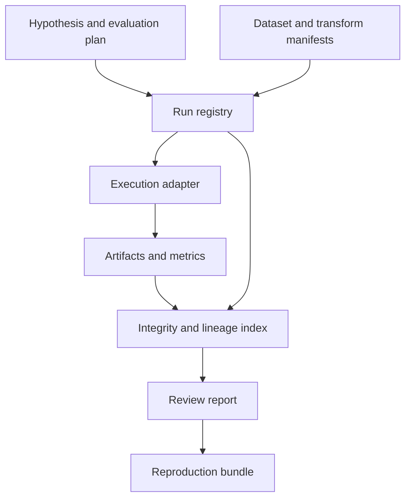

# TrailLedger — architecture

## Component boundaries

| Component | Owns | Boundary |
| --- | --- | --- |
| Manifest validator | Schema, hashes, graph edges, and completeness | Cannot infer scientific validity from valid metadata |
| Run registry | Lifecycle and unique operation identities | Owns metadata transactions |
| Execution adapter | Invoking or observing a domain runner | Does not reinterpret domain metrics |
| Artifact store | Content-addressed files and publication | Separate from credentials and raw restricted sources |
| Evaluation adapter | Metric meaning and split metadata | Domain-specific and versioned |
| Report renderer | Comparison and ancestry navigation | Cannot erase earlier trial evidence |

## State, control, and computation

Separate experiment identity from one execution attempt. A hypothesis and evaluation plan can generate many runs; a run may have multiple recorded attempts after interruption, but their outputs are never conflated. The lineage graph is acyclic and names exact input artifacts and transform versions. A content address identifies bytes, while a manifest adds semantic context such as units, schema, rights, and transformation intent. Identical bytes in different roles can share storage without becoming the same experiment.

## Deployment and dependency direction

The first deployment runs locally with explicit data and output directories. Domain logic must execute without a browser UI and without a sibling repository. The UI issues commands through an application boundary and reads materialized results; it never edits raw evidence or canonical domain state directly. File imports enter a staging area, validate, and only then become visible through a manifest.

Start with the fewest processes consistent with the domain. Add a process boundary when isolation, a different language runtime, or measured scheduling interference requires it. Do not introduce Kafka, Kubernetes, a shared remote database, or microservices to satisfy a diagram. Document resource limits, lock ownership, and crash recovery before adding concurrency.

## Fault containment

If a runner disappears, preserve its last observed state and reconcile its terminal record before retrying. An artifact hash mismatch quarantines that artifact and invalidates dependent completeness claims. Restricted inputs remain references with acquisition instructions and rights metadata. An import with broken edges is staged for diagnosis, not partially inserted into the accepted graph.

## Compatibility and observability

Domain interfaces are detailed in [INTERFACES.md](INTERFACES.md). Every run has an identity, a configuration fingerprint, a source revision, input references, and a terminal status. Diagnostic events link back to the smallest available unit of work. Structured logs carry correlation IDs and exclude credentials. Statistics state their units and observation windows. An operation that cannot establish input completeness must propagate that uncertainty rather than presenting a normal result.

## Extension rules

Adapters translate external formats at the boundary. They cannot redefine canonical semantics implicitly. A new source or execution adapter must pass the same fixture suite as the existing one and document unavailable capabilities. Cross-project contracts are accepted only after a synthetic round trip demonstrates version negotiation, duplicate behavior, and failure isolation.
